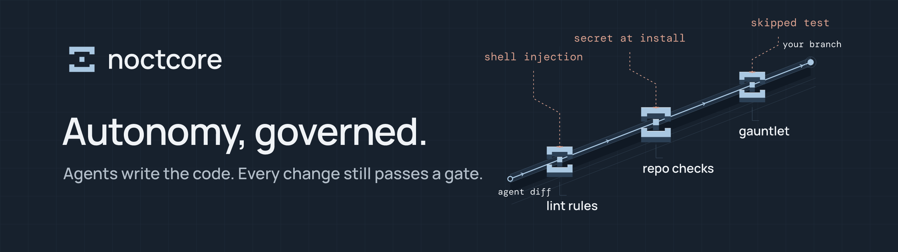

<div align="center">



<br/>

**Guardrails and tooling for AI-assisted software development.**

Local-first tools that let teams move fast with autonomous coding agents while keeping structure, review, and safety in human hands.

<br/>

[](https://www.npmjs.com/org/noctcore)
[](https://opensource.org/licenses/MIT)
[](https://github.com/noctcore)

</div>

---

### What we build

noctcore is home to a small family of developer tools built around one idea: autonomy is only useful when it is governed. Agents can write most of the code, but structure, review gates, and safety stay under your control. Everything we ship runs on your machine, keeps your data local, and stays legible so you always know what a tool did and why.

### Apps

| Project | What it is | Status | Get it |
| :-- | :-- | :-- | :-- |
| [**Nightcore**](https://github.com/noctcore/nightcore) | A local-first desktop studio that runs Claude (with Codex as an optional second provider) as an autonomous development team. Agents plan, build and test in isolated git worktrees, and nothing merges on trust: every change passes a verification gauntlet of build, lint, typecheck, the project's own structure rules and an independent reviewer agent. A Rust and Tauri core over a Bun provider sidecar. | Maintenance mode since v0.5.0: dependency and security updates and fixes, no new features | [Download the latest release](https://github.com/noctcore/nightcore/releases/latest) (macOS, Windows) |
| [**Nysia**](https://github.com/noctcore/nysia) | A terminal-first agentic development environment (Tauri v2 + Rust). Every tab is an agent or shell session over a headless `nysiad` daemon that owns the terminals and orchestration state, so the UI can close or crash without interrupting a running agent. Tasks come from GitHub Issues and start in branch-keyed worktrees. | In active development (v0.3, no binary release yet) | [Build from source](https://github.com/noctcore/nysia#development) |

### Libraries and SDKs

| Project | What it is | Status | Get it |
| :-- | :-- | :-- | :-- |
| [**auth**](https://github.com/noctcore/auth) | Authentication for TypeScript servers in the spirit of Lucia: sessions, Argon2id passwords, one-time tokens, throttling, CSRF and enumeration-safe flows over storage interfaces, one readable module per attack. Redis, Prisma, NestJS and tRPC adapters. | Early development, 0.5 previews on npm (not for production yet) | [Docs](https://noctcore.github.io/auth/) · [Example app](https://github.com/noctcore/auth/tree/main/examples/basic) |
| [**harness**](https://github.com/noctcore/harness) | Holds a TypeScript repo to its own rules in any CI: a check runner over a committed manifest, a lint-meta engine for whole-repo rules ESLint cannot reach, ready-made rules (`/rules`) and zizmor, actionlint and gitleaks pinned to an exact version (`/pinned-tools`). Zero runtime dependencies, no network, no account. | Shipped, 0.6 on npm | [Docs](https://noctcore.github.io/harness/) · `npx @noctcore/harness check` |
| [**ESLint plugins**](https://github.com/noctcore/eslint-plugins) | Fifteen focused plugins, a shared utils package and a catalog of whole-repo lint-meta rules. They catch architecture, contract, data-integrity and safety problems that generic linters can't see. | Shipped, on npm | [Docs](https://noctcore.github.io/eslint-plugins/) · [Where to start](https://github.com/noctcore/eslint-plugins#where-to-start) |
| [**showcase-kit**](https://github.com/noctcore/showcase-kit) | Capture, frame and export showcase images of desktop, web and terminal apps for READMEs and portfolios, from one config file. | Shipped, 0.3 on npm | [Docs](https://noctcore.github.io/showcase-kit/) · [Gallery](https://noctcore.github.io/showcase-kit/gallery/) |
| [**jobs**](https://github.com/noctcore/jobs) | BullMQ 6 for NestJS with the safe choice made the default: typed queues with required retry and retention policies, a dedupe on every enqueue, producers that fail fast during a Redis outage, sweeps that run once per tick across replicas and a shutdown that waits for running jobs. | Shipped, 0.1 on npm | [Docs](https://noctcore.github.io/jobs/) · [Getting started](https://noctcore.github.io/jobs/start/getting-started/) |

### Packages

The apps ship as installers or from source; the libraries are published on npm with provenance through npm trusted publishing. Each name links to its source.

#### auth

All five packages share one version. Pre-1.0: the API may change in any release.

| Package | npm | What it does | Docs |
| :-- | :-- | :-- | :-- |
| [`@noctcore/auth`](https://github.com/noctcore/auth/tree/main/packages/auth) | [](https://www.npmjs.com/package/@noctcore/auth) | The framework-free core: sessions, password hashing, one-time tokens, throttling and flows over storage interfaces, plus the Argon2id hasher and the two-factor, membership and invitations plugins as subpaths. | [docs](https://noctcore.github.io/auth/) |
| [`@noctcore/auth-redis`](https://github.com/noctcore/auth/tree/main/packages/auth-redis) | [](https://www.npmjs.com/package/@noctcore/auth-redis) | Redis session, counter, two-factor and membership stores on ioredis. | |
| [`@noctcore/auth-prisma`](https://github.com/noctcore/auth/tree/main/packages/auth-prisma) | [](https://www.npmjs.com/package/@noctcore/auth-prisma) | Prisma 7 user, one-time token, two-factor and membership stores, plus the schema to merge into yours. | |
| [`@noctcore/auth-nestjs`](https://github.com/noctcore/auth/tree/main/packages/auth-nestjs) | [](https://www.npmjs.com/package/@noctcore/auth-nestjs) | A NestJS module: a closed-by-default session guard, CSRF middleware, decorators and trust-proxy setup. | |
| [`@noctcore/auth-trpc`](https://github.com/noctcore/auth/tree/main/packages/auth-trpc) | [](https://www.npmjs.com/package/@noctcore/auth-trpc) | tRPC middlewares: a session context, guarded procedures, CSRF on mutations, safe error mapping and Zod schemas, for plain tRPC and nestjs-trpc. | |

#### harness

| Package | npm | What it does | Docs |
| :-- | :-- | :-- | :-- |
| [`@noctcore/harness`](https://github.com/noctcore/harness/tree/main/packages/harness) | [](https://www.npmjs.com/package/@noctcore/harness) | `harness check` runs the checks in a repo's manifest, `harness lint-meta` runs its whole-repo rule registry, `harness catalog` documents the rules. Subpaths: `/rules` (ready-made lint-meta rules) and `/pinned-tools` (zizmor, actionlint and gitleaks at a pinned version). | [docs](https://noctcore.github.io/harness/) |

#### ESLint plugins

Flat config only (ESLint 9+), each plugin versioned on its own.

| Package | npm | What it does | Docs |
| :-- | :-- | :-- | :-- |
| [`@noctcore/eslint-plugin-code-quality`](https://github.com/noctcore/eslint-plugins/tree/main/packages/eslint-plugin-code-quality) | [](https://www.npmjs.com/package/@noctcore/eslint-plugin-code-quality) | Guard clauses, comment and test hygiene, deterministic time, no stray `process.exit`. | [docs](https://noctcore.github.io/eslint-plugins/packages/code-quality/) |
| [`@noctcore/eslint-plugin-async-safety`](https://github.com/noctcore/eslint-plugins/tree/main/packages/eslint-plugin-async-safety) | [](https://www.npmjs.com/package/@noctcore/eslint-plugin-async-safety) | Fetch timeouts, `AbortSignal` forwarding, async races and shared mutable state. | [docs](https://noctcore.github.io/eslint-plugins/packages/async-safety/) |
| [`@noctcore/eslint-plugin-contracts`](https://github.com/noctcore/eslint-plugins/tree/main/packages/eslint-plugin-contracts) | [](https://www.npmjs.com/package/@noctcore/eslint-plugin-contracts) | IO boundaries (checked fetch, parsed boundary data), error cause and taxonomy, zod schema and wire naming, env access, decimal money, translation keys. | [docs](https://noctcore.github.io/eslint-plugins/packages/contracts/) |
| [`@noctcore/eslint-plugin-security`](https://github.com/noctcore/eslint-plugins/tree/main/packages/eslint-plugin-security) | [](https://www.npmjs.com/package/@noctcore/eslint-plugin-security) | Shell injection, path traversal, SSRF, open redirect, unsanitized HTML (XSS), timing-unsafe comparison, server actions that bypass their action client. | [docs](https://noctcore.github.io/eslint-plugins/packages/security/) |
| [`@noctcore/eslint-plugin-observability`](https://github.com/noctcore/eslint-plugins/tree/main/packages/eslint-plugin-observability) | [](https://www.npmjs.com/package/@noctcore/eslint-plugin-observability) | Structured logging: context objects over interpolation, no sensitive fields in logs, no lost error detail, declared PII in audit payloads. | [docs](https://noctcore.github.io/eslint-plugins/packages/observability/) |
| [`@noctcore/eslint-plugin-react`](https://github.com/noctcore/eslint-plugins/tree/main/packages/eslint-plugin-react) | [](https://www.npmjs.com/package/@noctcore/eslint-plugin-react) | React architecture and correctness (prop drilling, state colocation, memoized context, effect safety, guarded web storage). | [docs](https://noctcore.github.io/eslint-plugins/packages/react/) |
| [`@noctcore/eslint-plugin-rsc`](https://github.com/noctcore/eslint-plugins/tree/main/packages/eslint-plugin-rsc) | [](https://www.npmjs.com/package/@noctcore/eslint-plugin-rsc) | React Server Components and App Router correctness (navigation errors that must not be swallowed). | [docs](https://noctcore.github.io/eslint-plugins/packages/rsc/) |
| [`@noctcore/eslint-plugin-llm`](https://github.com/noctcore/eslint-plugins/tree/main/packages/eslint-plugin-llm) | [](https://www.npmjs.com/package/@noctcore/eslint-plugin-llm) | LLM output treated as untrusted input before it reaches a sink. | [docs](https://noctcore.github.io/eslint-plugins/packages/llm/) |
| [`@noctcore/eslint-plugin-nestjs`](https://github.com/noctcore/eslint-plugins/tree/main/packages/eslint-plugin-nestjs) | [](https://www.npmjs.com/package/@noctcore/eslint-plugin-nestjs) | NestJS and BullMQ background work (queue jobs keyed against retries, shared queue and job names, schedules with a stated time zone). | [docs](https://noctcore.github.io/eslint-plugins/packages/nestjs/) |
| [`@noctcore/eslint-plugin-query`](https://github.com/noctcore/eslint-plugins/tree/main/packages/eslint-plugin-query) | [](https://www.npmjs.com/package/@noctcore/eslint-plugin-query) | TanStack Query and tRPC cache correctness (invalidations that reach infinite queries, mutation callbacks that survive a remount, handled mutation errors). | [docs](https://noctcore.github.io/eslint-plugins/packages/query/) |
| [`@noctcore/eslint-plugin-electron`](https://github.com/noctcore/eslint-plugins/tree/main/packages/eslint-plugin-electron) | [](https://www.npmjs.com/package/@noctcore/eslint-plugin-electron) | Electron main-process security (renderer isolation flags, IPC sender checks, `shell` kept to one module). | [docs](https://noctcore.github.io/eslint-plugins/packages/electron/) |
| [`@noctcore/eslint-plugin-dates`](https://github.com/noctcore/eslint-plugins/tree/main/packages/eslint-plugin-dates) | [](https://www.npmjs.com/package/@noctcore/eslint-plugin-dates) | Calendar days read in one zone (local `Date` accessors, date-only parsing, hand-rolled day arithmetic kept to one calendar module). | [docs](https://noctcore.github.io/eslint-plugins/packages/dates/) |
| [`@noctcore/eslint-plugin-prisma`](https://github.com/noctcore/eslint-plugins/tree/main/packages/eslint-plugin-prisma) | [](https://www.npmjs.com/package/@noctcore/eslint-plugin-prisma) | Prisma tenancy, soft-delete and transaction guardrails (tenant-scope escape hatches, raw SQL, request-body writes, single-writer models, audit placement). | [docs](https://noctcore.github.io/eslint-plugins/packages/prisma/) |
| [`@noctcore/eslint-plugin-architecture`](https://github.com/noctcore/eslint-plugins/tree/main/packages/eslint-plugin-architecture) | [](https://www.npmjs.com/package/@noctcore/eslint-plugin-architecture) | Module and folder shape (folder-per-component, barrels, feature boundaries, import depth, colocated tests). | [docs](https://noctcore.github.io/eslint-plugins/packages/architecture/) |
| [`@noctcore/eslint-plugin-monorepo`](https://github.com/noctcore/eslint-plugins/tree/main/packages/eslint-plugin-monorepo) | [](https://www.npmjs.com/package/@noctcore/eslint-plugin-monorepo) | Workspace package boundaries (barrel-only and exports-map-aware imports); needs your workspace scope. | [docs](https://noctcore.github.io/eslint-plugins/packages/monorepo/) |
| [`@noctcore/lint-meta-rules`](https://github.com/noctcore/eslint-plugins/tree/main/packages/lint-meta-rules) | [](https://www.npmjs.com/package/@noctcore/lint-meta-rules) | Whole-repo rules ESLint can't reach (package naming, declared workspace deps, file-size ratchets), run by `harness lint-meta`. | [docs](https://noctcore.github.io/eslint-plugins/packages/lint-meta-rules/) |
| [`@noctcore/eslint-utils`](https://github.com/noctcore/eslint-plugins/tree/main/packages/eslint-utils) | [](https://www.npmjs.com/package/@noctcore/eslint-utils) | Shared rule-creator and AST helpers the plugins are built on. |  |

#### showcase-kit

| Package | npm | What it does | Docs |
| :-- | :-- | :-- | :-- |
| [`@noctcore/showcase-kit`](https://github.com/noctcore/showcase-kit) | [](https://www.npmjs.com/package/@noctcore/showcase-kit) | The `showcase` CLI: raw captures, framed README images, portfolio images, hero banners, terminal clips and app icons from one config. | [docs](https://noctcore.github.io/showcase-kit/) |

#### jobs

Pre-1.0: the API may change in any minor release.

| Package | npm | What it does | Docs |
| :-- | :-- | :-- | :-- |
| [`@noctcore/jobs`](https://github.com/noctcore/jobs/tree/main/packages/jobs) | [](https://www.npmjs.com/package/@noctcore/jobs) | `defineQueue` with a typed policy, `queue.add` with a required dedupe, `@Worker` on a `JobHost` base, `@Sweep` on BullMQ job schedulers, `installGracefulShutdown`, and Prometheus, OpenTelemetry and Sentry adapters. | [docs](https://noctcore.github.io/jobs/) |

### Quickstart

#### auth

```sh
npm i @noctcore/auth @node-rs/argon2          # the core and its optional Argon2id peer
npm i @noctcore/auth-redis @noctcore/auth-prisma   # the store adapters, as you need them
```

The [getting started guide](https://noctcore.github.io/auth/start/getting-started/) wires the stores and calls the flows from your own routes.

#### harness

List the checks in the repo's manifest (`.noctcore/harness.json` since 0.6.0; the old `.nightcore/harness.json` is still read until 1.0), then run them locally or as a CI step:

```sh
npx @noctcore/harness check
npx @noctcore/harness lint-meta   # whole-repo rules from a committed registry
```

A check that could not run is a failure, never a pass. The [docs](https://noctcore.github.io/harness/) cover the manifest, writing a rule, baselines and pinned tools.

#### jobs

```sh
npm i @noctcore/jobs bullmq ioredis   # or bun add / pnpm add
```

Define a queue with its policy, enqueue with a dedupe, process it in a `JobHost` worker. The [getting started guide](https://noctcore.github.io/jobs/start/getting-started/) builds one queue end to end.

#### ESLint plugins

Every rule, its options, and the presets are documented at [noctcore.github.io/eslint-plugins](https://noctcore.github.io/eslint-plugins/).

```sh
npm i -D @noctcore/eslint-plugin-code-quality @typescript-eslint/parser   # or bun add -D / pnpm add -D
```

```js
// eslint.config.js (flat config). The presets set no `files` and no parser, so give them both.
import tsParser from '@typescript-eslint/parser';
import codeQuality from '@noctcore/eslint-plugin-code-quality';

export default [
  {
    ...codeQuality.configs.recommended,
    files: ['**/*.{ts,tsx}'],
    languageOptions: { parser: tsParser },
  },
];
```

New here? Start with `code-quality`, `async-safety` and `contracts`, then add the plugins for your stack. The [Where to start](https://github.com/noctcore/eslint-plugins#where-to-start) guide has a combined config.

### Principles

- **Local-first.** Your code and your data stay on your machine. No hosted anything, no phone-home.
- **Governed autonomy.** Agents move fast inside guardrails you define, not around them.
- **Legible by default.** Every action a tool takes is visible and reviewable, never a black box.
- **Downstream-owned.** What we generate, you own. Edit it, extend it, or throw it away.

### Links

- npm: [npmjs.com/org/noctcore](https://www.npmjs.com/org/noctcore)
- auth docs: [noctcore.github.io/auth](https://noctcore.github.io/auth/)
- harness docs: [noctcore.github.io/harness](https://noctcore.github.io/harness/)
- ESLint plugin docs: [noctcore.github.io/eslint-plugins](https://noctcore.github.io/eslint-plugins/)
- showcase-kit docs: [noctcore.github.io/showcase-kit](https://noctcore.github.io/showcase-kit/)
- jobs docs: [noctcore.github.io/jobs](https://noctcore.github.io/jobs/)
- Nightcore releases: [github.com/noctcore/nightcore/releases](https://github.com/noctcore/nightcore/releases)
- Web: [shirone.dev](https://shirone.dev)
- Contact: [support@shirone.dev](mailto:support@shirone.dev)

<div align="center">
<br/>
<sub>Built with care by noctcore. Ship fast, stay in control.</sub>
</div>
